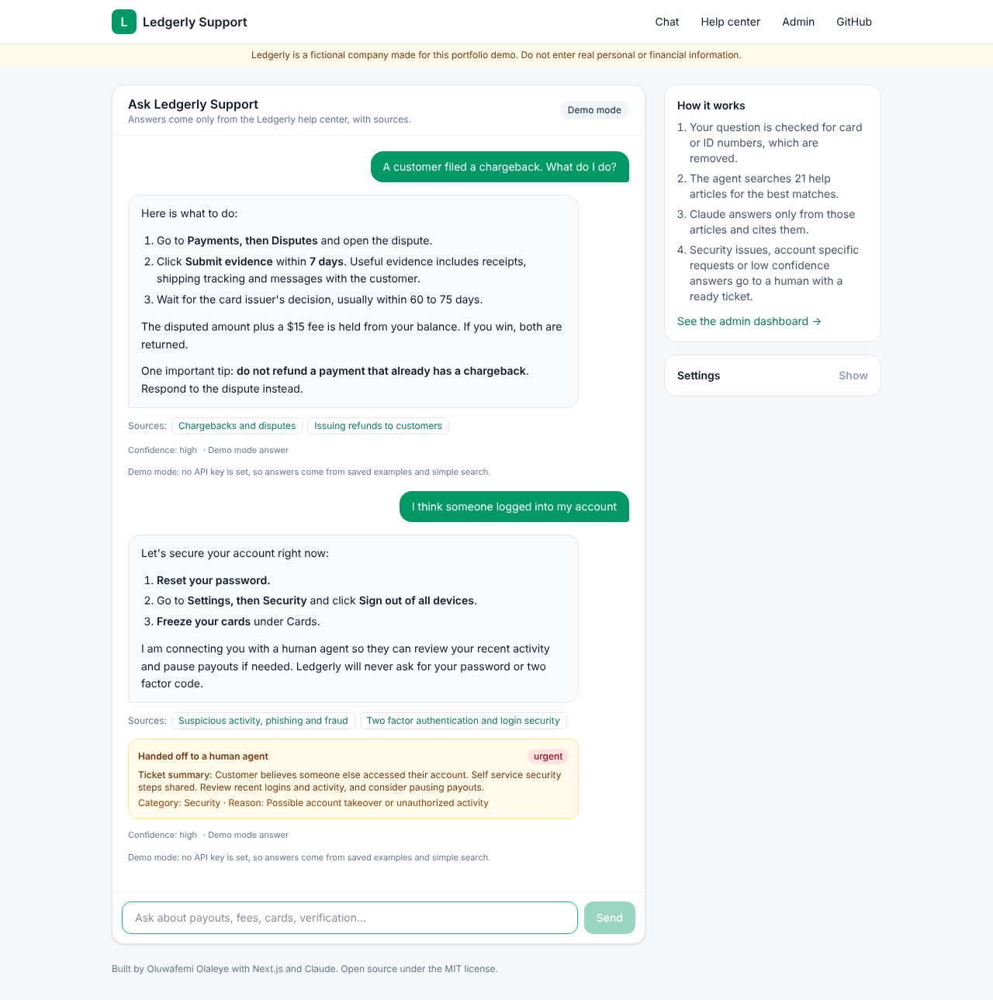
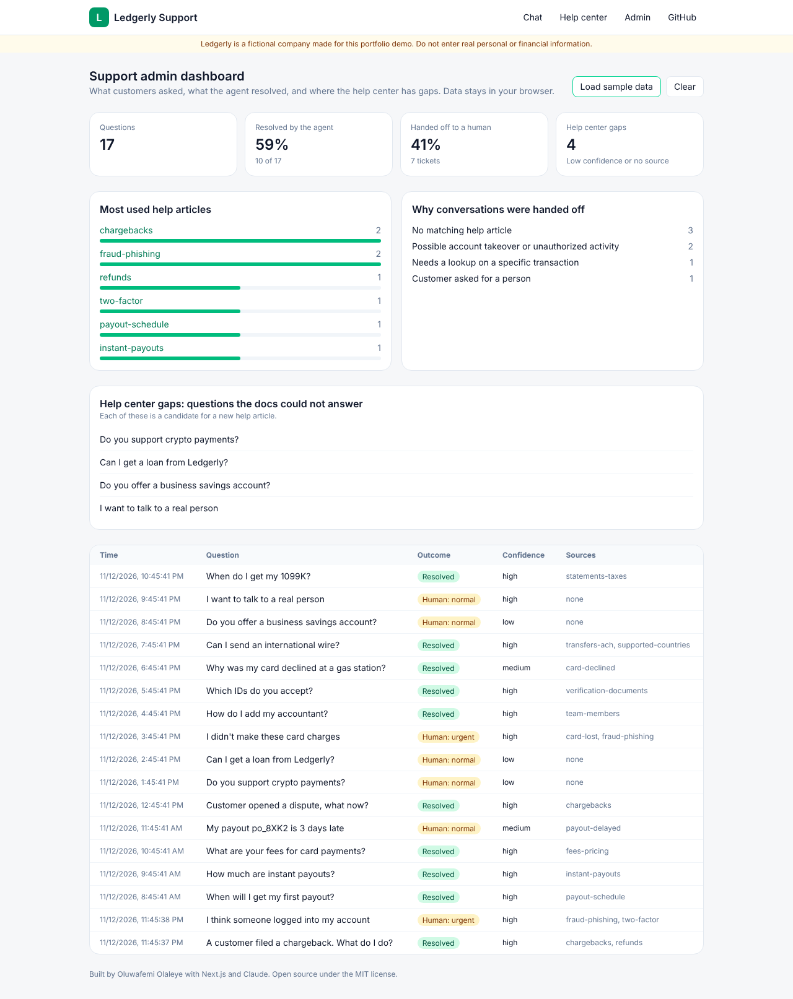
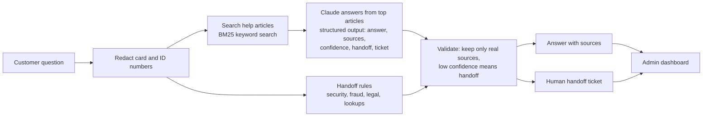

# Ledgerly Support Agent

**An AI customer support agent for a fintech startup that answers only from the company's help center, cites its sources, and hands risky or account specific questions to a human with a ready to use ticket.**

**Live demo:** https://ai-support-agent-nu-two.vercel.app/ Works with no setup: click a sample question.

> Ledgerly is a fictional company created for this portfolio project. All help articles and data are made up.





## The problem

Support is one of the biggest costs for an early stage fintech startup. Most tickets ask the same questions (payout timing, fees, chargebacks, verification), but money questions cannot be answered with a guess. A wrong fee or a confident answer to a fraud report causes real harm. Startups need an assistant that:

* answers routine questions instantly and correctly,
* shows where every answer came from,
* never pretends to see or change a customer's account,
* and knows when to hand off to a human, with the context already written up.

## What it does

| Feature | Why it matters |
|---|---|
| Answers only from 21 help articles, with clickable sources | Customers and agents can verify every answer |
| Guaranteed human handoff for security, fraud, legal and transaction lookups | Rules run before and after the model, so the most important behavior never depends on the model alone |
| Ready to use handoff ticket (summary, category, priority) | The human agent does not need to reread the whole chat |
| Removes card numbers and ID numbers before anything is processed | Sensitive data never reaches the model or logs |
| Admin dashboard: resolution rate, handoff reasons, most used articles, help center gaps | Shows the business what to fix next in its docs |
| Demo mode with saved answers | Anyone can try it with no API key; the live demo never breaks |
| Optional "use your own API key" setting | Unlimited use for visitors, key kept only in their browser tab |
| Offline eval script | Measures retrieval and handoff quality on every change |

## How it works



* **Search:** a small BM25 keyword search over markdown files, with a synonym list for everyday words ("money" maps to payouts, "dispute" to chargebacks). No database or paid service needed.
* **Answering:** Claude is forced to reply through a tool with a fixed schema, so every answer has sources, a confidence level and a handoff decision. Sources that were not in the retrieved articles are dropped.
* **Guardrails:** hard rules always trigger a handoff for account takeover, fraud, legal or regulator mentions, specific payout or transfer IDs, and requests for a person. Low confidence answers also hand off.
* **No API key?** The app falls back to saved answers for the sample questions, or a direct excerpt from the best matching article. Weak matches go to a human instead of guessing.

## Results (offline eval)

Run `npm run eval`. Current results on 30 test questions:

| Check | Result |
|---|---|
| Right article in the top 3 search results | 27/27 (100%) |
| Right article ranked first | 23/27 (85%) |
| Handoff rules correct (should vs should not hand off) | 30/30 (100%) |
| Card and ID number redaction | 3/3 |

Honest note: these test questions were also used while tuning the synonym list and rules, so the numbers are optimistic. The next step is a held out set of questions written by someone else, plus a live eval of the full model answers (see project #10 in my portfolio plan).

## Try it locally (about 5 minutes)

You need Node.js 20 or newer.

```bash
git clone https://github.com/OluwafemiPaul/ai-support-agent.git
cd ai-support-agent
npm install
cp .env.example .env.local   # then paste your Anthropic API key (optional)
npm run dev
```

Open http://localhost:3000. Without a key the app runs in demo mode.

Other commands:

```bash
npm run eval    # offline eval of search and handoff rules
npm run build   # production build
```

## Deploy your own copy on Vercel

1. Fork or push this repo to your GitHub.
2. In Vercel, click **Add New, then Project**, and import the repo. When GitHub asks, choose **Only select repositories** and pick just this one.
3. Under **Environment Variables**, add `ANTHROPIC_API_KEY` (and optionally `ANTHROPIC_MODEL` and `DAILY_LIMIT_PER_IP`).
4. Click **Deploy**.

Set a monthly spend limit in the Anthropic Console before sharing the link. The app also limits each visitor to 20 live answers per day by default.

## Use it with your own company's docs

Replace the files in `knowledge-base/` with your own help articles. Each file needs a short header:

```markdown
---
title: How refunds work
category: Payments
---

Article text in markdown...
```

Then update the saved sample answers in `lib/demo.ts` and the test questions in `evals/cases.json`.

## Project structure

```
app/
  page.tsx            Chat page
  admin/page.tsx      Admin dashboard
  docs/               Help center pages (the sources)
  api/chat/route.ts   Redact, search, rules, Claude, validate
lib/
  agent.ts            Claude call with a structured reply schema
  retrieval.ts        BM25 search and synonyms
  policy.ts           Redaction and handoff rules
  demo.ts             Demo mode answers
knowledge-base/       21 fictional Ledgerly help articles
evals/cases.json      Test questions
scripts/eval.ts       Offline eval
```

## Known limitations

* Keyword search can miss questions phrased very differently from the docs. Embeddings would help as the help center grows.
* The per visitor limit is kept in memory, so it resets when a server restarts. Production should use a shared store such as Redis. The Anthropic Console spend limit is the real cost cap.
* Admin dashboard data lives in each visitor's browser (no server database), which keeps the demo private but means it is not shared across users.
* The handoff creates a ticket on screen only. A real deployment would send it to a help desk such as Zendesk, Intercom or Linear.

## What I would build next

* Send handoff tickets to a real help desk through its API.
* Add embeddings search and compare it with BM25 in the eval.
* A live eval that grades full answers for accuracy, sources and tone.
* A feedback button (helpful or not helpful) to measure answer quality with real users.

## Case study

**Who it is for:** support leads at early stage fintech startups who want to cut repetitive tickets without risking wrong answers about money.

**Key decisions and tradeoffs**
* **Rules plus model, not model only.** For security and fraud, a missed handoff is far worse than an extra one, so those cases are guaranteed by code and the model adds judgment on top.
* **Structured output over free text.** Forcing a schema made sources, confidence and handoff measurable, which is what made the admin dashboard and evals possible.
* **Keyword search before embeddings.** For 21 articles, BM25 was accurate, free and easy to explain. The eval makes it easy to test a switch later.
* **Demo mode as a first class feature.** A portfolio link that breaks when a key expires is worse than no link, so every path has a fallback.

## Tech

Next.js 16, React 19, TypeScript, Tailwind CSS 4, Anthropic Claude API (default model `claude-haiku-5-5`), deployed on Vercel.

## Recording the demo

Record a short screen capture showing: a sample question with sources, a fee question, a security question that hands off with a ticket, and the admin dashboard. Save it as `docs/demo.gif` (or upload an MP4 to the README on GitHub).

## License

MIT. See [LICENSE](LICENSE).
